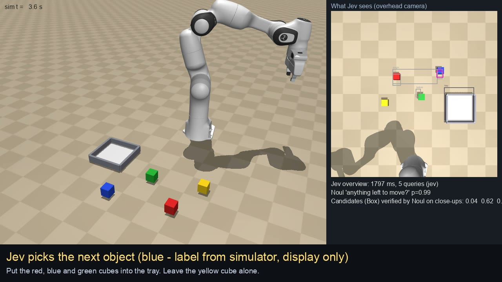

# jev-tabletop

A simulated Franka Panda tidies objects into a tray following a natural-language instruction
(English or Japanese). All perception and task-level decisions come from
[TypeSafe Jev](https://docs.typesafe.ai), a "System One" decision model with image input.
Nothing is trained and no demonstrations are used. The robot runs in MuJoCo, wired as a
[dora-rs](https://github.com/dora-rs/dora) dataflow.



Course project for the Physical AI course (final assignment). The slide report is submitted
separately; the "slide" references below point to it.

## How it works

Jev never outputs trajectories or torques. It answers typed questions about camera images;
hand-written motion primitives (`pick(x, y)`, `place(x, y)`, `park`) and a damped-least-squares
IK execute the motion.

| query | image | questions (evaluated in parallel in one request) |
|---|---|---|
| overview | overhead camera | Box x4: an object the instruction asks to move that is still outside the tray (4 spatial tie-breakers: single / leftmost / topmost / bottommost); Box: the tray; Noul: is anything left to move?; Noul: is the last object in the tray? |
| verify | 9 cm close-up of each candidate | Noul: is there an object at the centre?; Noul: is it one the instruction asks to move? |
| refine | zoomed overhead crop + close-up of the chosen object | Box: the object that looks like the close-up; Noul: is it visible? |
| grasp check | wrist camera | Noul: is the gripper grasping an object?; Noul: is there an object between the fingers? |

- No object names in the code: the instruction is passed to Jev as text and every question
  refers to "an object that `instruction` asks to put into the tray". A chosen object is then
  tracked by appearance (its close-up is passed as a reference image). Names such as "red" in
  videos and logs are labels taken from the simulator for display and evaluation only.
- Confidence: Box answers with confidence < 0.3 are rejected and re-asked on a wider crop;
  zooming stops after one accepted answer with confidence >= 0.5.
- Closed loop: after each pick the wrist-camera check decides "go on / retry" (mean of the two
  Noul probabilities >= 0.5). After each place the next overview re-checks the scene.
- Sensors used for control are those a real cell has: a fixed overhead camera, a wrist camera
  rigidly mounted on the hand, joint encoders. Simulator ground truth is used only to score
  runs (and in the `PERCEPTION=oracle` debugging mode, which replaces Jev with ground truth).
- Assumptions of the motion primitives: objects of about 4.4 cm with a known height, grasped
  from above, on a flat floor; the camera intrinsics and extrinsics are known.

## Requirements

- macOS on Apple Silicon (tested on an M3 MacBook). Linux should work but is untested.
- [uv](https://docs.astral.sh/uv/) (Python 3.13 is installed by `uv sync`), `ffmpeg` (only for
  assembling the submission video), `git`.
- A TypeSafe API key. Image questions need the `TypeSafe-Danger-Zone-Images: true` header,
  which the code sends. One episode (three objects) costs about USD 0.0013.

## Setup

```bash
uv sync
./scripts/fetch_assets.sh          # Franka Panda from MuJoCo Menagerie (Apache-2.0)
cp .env.example .env               # then put your TYPESAFE_API_KEY in .env
```

## Run one episode

```bash
RUN_DIR=outputs/demo uv run dora run dataflow.yml
```

Settings are environment variables:

| variable | meaning (default) |
|---|---|
| `RUN_DIR` | output directory |
| `INSTRUCTION` | instruction text (`Put the red, blue and green cubes into the tray. Leave the yellow cube alone.`) |
| `LAYOUT_SEED` | random object layout (unset: fixed default layout) |
| `OBJECTS` | `colour[:shape],...`; colours red green blue yellow purple orange, shapes cube cylinder; needs `LAYOUT_SEED` (four cubes) |
| `DISTURB_STEP` | during this pick (0-based) the target object is moved 9 cm to imitate a person (off) |
| `PERCEPTION` | `oracle` replaces Jev with simulator ground truth (`jev`) |
| `NO_VIDEO` | `1` skips video recording |
| `TITLE` | title card of the recorded video |
| `JEV_MODEL` | Jev model (`jev-1.14.0`, the version used for all results) |

Each run writes `run.mp4` (robot view, what Jev saw, and the current decision),
`jev_log.jsonl` (every Jev request and answer with latency and tokens), `metrics.jsonl`
(decisions, grasp-point error against ground truth, grasp checks) and `final_state.json`.

Examples:

```bash
# an object that was not used during development, Japanese instruction
OBJECTS=red,green,blue,yellow,purple,orange:cylinder LAYOUT_SEED=23 \
INSTRUCTION="紫のキューブとオレンジの円柱をトレイに入れて。" RUN_DIR=outputs/new_objects \
  uv run dora run dataflow.yml

# disturbance during the second pick: the grasp check detects the miss and the robot retries
DISTURB_STEP=1 RUN_DIR=outputs/disturbance uv run dora run dataflow.yml
```

### Interactive mode

```bash
INTERACTIVE=1 LIVE=1 RUN_DIR=outputs/interactive uv run dora run dataflow_interactive.yml
```

Open http://127.0.0.1:8765 for the live view, type an instruction, or shuffle the objects.
The Speak button uses the browser's speech recognition; it needs microphone permission in
the browser and in macOS, and works in Google Chrome or Safari only.

## Reproducing the report

Saved logs of the runs behind each table are in [`results/`](results/) (no images or videos).
Jev answers are not bit-exact across runs, so a re-run can differ in individual decisions.

| report | command | saved logs |
|---|---|---|
| slide 7: query formats on development images | `uv run python scripts/probe_openvocab.py outputs/probe_ov2`, then `uv run python scripts/probe_openvocab_verify.py outputs/probe_ov2 outputs/probe_ov3` | `results/probe/` |
| slide 8: Box confidence vs. error (97 estimates) | `uv run python scripts/conf_analysis.py --csv out.csv LABEL=RUN_DIR ...` over the logs of the earlier stages (tags `exp-v1`, `exp-v2`), all estimates logged before the confidence gate existed | `results/conf_analysis/report96.csv` |
| slide 8, 12: one vs. two zoom rounds | `EXP_NAME=dev_ov STOP_CONF=none uv run python scripts/experiments.py dev`, then `uv run python scripts/zoom_analysis.py outputs/dev_ov` | `results/dev_set_two_zoom_rounds/` |
| slide 10: development set (5 layouts, 7 instructions) | `EXP_NAME=exp_ov_final uv run python scripts/experiments.py final && EXP_NAME=exp_ov_final uv run python scripts/experiments.py summary` | `results/dev_set/` |
| slide 11: unseen conditions (11, defined in `scripts/heldout.py` before the runs) | `uv run python scripts/heldout.py run new && uv run python scripts/heldout.py summary` | `results/heldout/` |
| slide 13 and the video: demos | see below | `results/demos/` |

```bash
RUN_DIR=outputs/demo_ov/demo1 TITLE="Demo 1: explicit instruction" uv run dora run dataflow.yml
OBJECTS=red,green,blue,yellow,purple,orange:cylinder LAYOUT_SEED=23 INSTRUCTION="紫のキューブとオレンジの円柱をトレイに入れて。" \
  RUN_DIR=outputs/demo_ov/demo2_take2 TITLE="Demo 2: new objects (purple cube, orange cylinder)" uv run dora run dataflow.yml
DISTURB_STEP=1 RUN_DIR=outputs/demo_ov/demo3 TITLE="Demo 3: disturbance and recovery" uv run dora run dataflow.yml

# submission video (title cards from scripts/final_video_cards.json, 1.5x speed)
uv run python scripts/make_final_video.py OUT.mp4 --speed 1.5 --cards scripts/final_video_cards.json \
  --op OP.mp4 --ed ED.mp4 outputs/demo_ov/demo1/run.mp4 outputs/demo_ov/demo2_take2/run.mp4 outputs/demo_ov/demo3/run.mp4
```

Demo 2 was recorded three times with the same instruction: `LAYOUT_SEED=21` (success after
three missed grasps of the cylinder, all detected), `LAYOUT_SEED=23` (success, used in the
video) and `LAYOUT_SEED=23` again (ended without moving anything). The demo 2 recording used
in the video predates the CJK font fallback in `tabletop/video.py`; its Japanese banner text
was redrawn with `scripts/fix_banner_text.py`.

Layout seeds 1-6 were used during development, 7-17 only for the unseen conditions.

## Repository layout

```
dataflow.yml               dora graph: sim, controller, brain
dataflow_interactive.yml   the same plus the web UI node
nodes/sim.py               MuJoCo physics, overhead / front / wrist cameras, video recorder
nodes/controller.py        motion primitives -> Cartesian waypoints -> IK -> joint targets (50 Hz)
nodes/brain.py             task loop: Jev queries -> motion commands, grasp check, metrics
nodes/ui.py                web UI for the interactive mode
tabletop/scene.py          scene, objects, cameras, pixel <-> floor-plane geometry
tabletop/jev.py            Jev questions (Box / Noul, no object names) + oracle mode
tabletop/locate.py         zoomed re-localisation with Box (confidence gate, adaptive depth)
tabletop/ik.py             damped-least-squares IK with several initial guesses
tabletop/video.py          video composition (robot view, what Jev saw, banner)
scripts/                   experiments, analyses and video assembly (see above)
results/                   logs of the runs reported in the slides
```

## Development history

Git tags mark the stages: `exp-v1` (first version), `exp-v2` (IK fix), `exp-v3` (confidence
gate), `closed-vocab-v3` (same, before removing object names from the questions; its questions
listed the four colours), `openvocab-frozen` (the code evaluated in the report; later commits
change only defaults, documentation, analysis scripts, the web UI and video rendering).

## License

MIT (see [LICENSE](LICENSE)). The Franka Panda model fetched by `scripts/fetch_assets.sh` comes from MuJoCo Menagerie under Apache-2.0.
